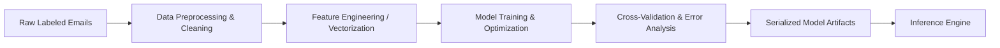

# Machine Learning & NLP Pipeline (Conceptual Architecture)

> [!NOTE]
> This document specifies the conceptual architectural roadmap for future NLP/ML-driven inbound email intent parsing. The current production-ready implementation processes structured tabular reminder datasets (`data/reminders.csv`) with deterministic timezone scheduling and SQLite atomic persistence.

---

## 1. Objectives of the Learning System

The intelligence layer performs two primary tasks:
1. **Intent Classification**: Determining whether an incoming email represents an actionable reminder/task or generic informational correspondence.
2. **Temporal & Entity Extraction**: Identifying *what* needs to be done (the action item) and *when* it is due (the target deadline or reminder time).

---

## 2. Model Architecture & Approach

### 2.1 Intent Classifier
* **Task**: Binary / Multi-class text classification.
  * *Classes*: `ACTIONABLE_REMINDER`, `MEETING_REQUEST`, `DEADLINE_ALERT`, `INFORMATIONAL` (non-actionable).
* **Baseline Approach**:
  * Feature Extraction: Term Frequency-Inverse Document Frequency (TF-IDF) with n-gram range (1, 2).
  * Classifier: Logistic Regression / Support Vector Machine (LinearSVC) / Multinomial Naive Bayes.
* **Advanced Approach (Optional / Extensible)**:
  * Fine-tuned lightweight Transformer (e.g., DistilBERT / MiniLM) for semantic context understanding.

### 2.2 Temporal Entity Extraction (NER & Date Resolution)
* **Hybrid Extraction Architecture**:
  1. **Named Entity Recognition (NER)**: Detects date/time tokens and task descriptions within the context window.
  2. **Rule-Based Normalizer**: Resolves relative expressions ("tomorrow at 4pm", "in two days", "next Friday morning") into absolute ISO-8601 UTC timestamps using reference anchoring.

---

## 3. How the Model Learns

1. **Preprocessing**:
   - Removal of email boilerplate (disclaimers, headers, signature blocks).
   - Text normalization (lowercasing, special character sanitization).
2. **Feature Representation**:
   - N-gram TF-IDF representations weighted with sublinear term frequency.
3. **Training & Optimization**:
   - Loss Function: Cross-entropy loss / Log loss.
   - Optimization: L2 regularization to prevent overfitting on specific email senders or domain-specific jargon.
4. **Evaluation Metrics**:
   - Precision (minimizing false alarms/unwanted reminders).
   - Recall (minimizing missed deadlines).
   - F1-Score & ROC-AUC for class balance verification.
